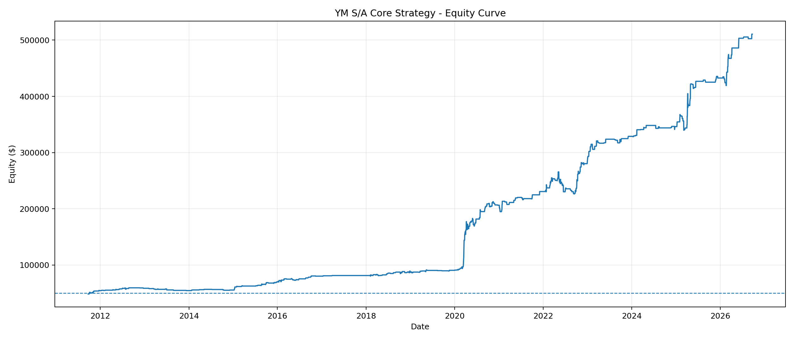
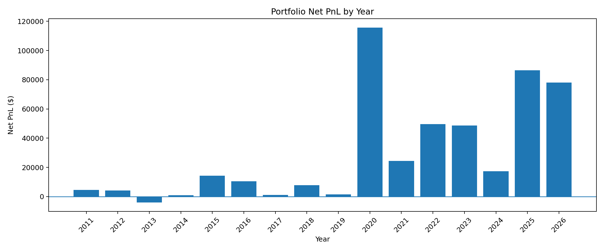
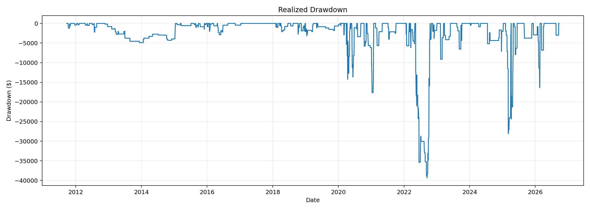

# YM Intraday Quantitative Strategy | 15-Year Backtest: +921.28% Total Return, 16.76% CAGR

**English** · [中文版](README.md)

This repository also archives the [early fitted 12-rule strategy (English)](versions/ym_12_rule_fitted/README.en.md) and its [Chinese edition](versions/ym_12_rule_fitted/README.md). Its matching source code is available; the 30% margin-budget simulation returned +1,384.98% in total, or 19.71% CAGR, but uses a retrospective valid-day filter that needs correction. Its rules are distinct from the later five-rule portfolio. **All figures below apply only to the later five-rule S/A portfolio.**

This repository presents the supplied backtest archive for a five-rule YM intraday futures portfolio (S1, S2, A1, A2 and A3). It includes trade-level results, charts and a consistency-check script. **All returns are historical simulations, not live results or forecasts.** The original five-rule backtest engine was not included in the archive, so these results cannot be independently regenerated from this repository.

## Backtest summary

| Item | Result / assumption |
|---|---:|
| Instrument | CME E-mini Dow Jones Industrial Average futures (YM), $5 per index point per contract |
| Market data | Databento `GLBX.MDP3`, `ohlcv-1m`, continuous `YM.v.0`, as recorded in the supplied research materials |
| Period | September 23, 2011 – September 22, 2026 (about 15 years; partial 2011 and 2026) |
| Initial / ending simulated equity | $50,000 / $510,640 |
| Net profit / total return / CAGR | **$460,640 / +921.28% / 16.76%** |
| Completed portfolio trades | **406** (358 short, 48 long); this is not a count of broker order messages |
| Win rate / profit factor | 59.85% / 2.29 |
| Annualized daily Sharpe / reported Sortino | 1.36 / 1.00 |
| Maximum close-to-close / intraday drawdown | −14.80% / −15.07% |
| Assumed transaction costs | $2.50 commission per contract per side; 1 adverse index point of slippage per side; $15 total per contract round trip |
| Position sizing | Margin **budget** = 50% of pre-trade equity; modeled margin used = 37.82%–49.99% of equity; 3–12 contracts per portfolio trade |

Sharpe uses daily equity changes, √252 annualization and no risk-free-rate adjustment. CAGR uses the calendar span above. The 50% figure is a *margin budget*, not a 50% maximum-loss rule. The model assigns margin per contract at 9% of YM notional value; this is a research sizing proxy, **not an actual historical broker or CME margin schedule**. The `CONTRACTS=1` configuration applies to standalone rule diagnostics; actual portfolio sizes come from the trade log.

## Rules and trading schedule

Entries occur at **09:30 or 09:45 America/New_York**; scheduled exits occur at **09:45, 10:00 or 10:30**. The trade log also contains early exits on opposing signals. The conditions below are transcribed from the supplied `config.json`. Exact feature construction and intrabar fill logic require the missing source.

| Rule | Side | Entry → scheduled exit (New York time) | Archived condition |
|---|---|---|---|
| S1 | Long | 09:45 → 10:30 | `ov_ret <= -0.29% AND europe >= +0.14%` |
| S2 | Short | 09:30 → 10:00 | `pre <= -0.19% AND late30 >= +0.03%` |
| A1 | Short | 09:30 → 10:00 | `asia >= +0.13% AND europe <= -0.29%` |
| A2 | Short | 09:45 → 10:30 | `evening <= -0.27% AND prev_rth_closepos >= 0.75` |
| A3 | Short | 09:45 → 10:30 | `ov_ret <= -0.28% AND prev_rth_ret >= +0.80%` |

Several signals may contribute to one portfolio trade. The independent one-contract diagnostics in `strategy_summary.csv` and `strategy_independent_trades.csv` **must not** be added to the dynamically sized portfolio result.

## Annual results

| Year | Completed trades | Simulated net P&L |
|---:|---:|---:|
| 2011* | 13 | $4,520 |
| 2012 | 25 | $4,165 |
| 2013 | 11 | −$4,090 |
| 2014 | 11 | $930 |
| 2015 | 30 | $14,250 |
| 2016 | 27 | $10,445 |
| 2017 | 2 | $1,120 |
| 2018 | 35 | $7,875 |
| 2019 | 20 | $1,405 |
| 2020 | 66 | $115,750 |
| 2021 | 22 | $24,360 |
| 2022 | 54 | $49,560 |
| 2023 | 25 | $48,575 |
| 2024 | 16 | $17,385 |
| 2025 | 31 | $86,385 |
| 2026* | 18 | $78,005 |

\* Partial years. Performance in 2020 and 2025–2026 makes a large contribution to the total. The archive does not establish an independent out-of-sample period or document how the rules were selected.

## Charts

More charts are in [`reports/ym_sa/charts`](reports/ym_sa/charts).

## Files and verification

- [`portfolio_trades.csv`](reports/ym_sa/portfolio_trades.csv): all 406 completed portfolio trades, including timestamps, signals, position sizes, net P&L and modeled margin.
- [`portfolio_summary.csv`](reports/ym_sa/portfolio_summary.csv), [`portfolio_yearly.csv`](reports/ym_sa/portfolio_yearly.csv), [`portfolio_monthly.csv`](reports/ym_sa/portfolio_monthly.csv): summary and annual/monthly results.
- [`daily_equity_drawdown.csv`](reports/ym_sa/daily_equity_drawdown.csv), [`intraday_equity_drawdown.csv`](reports/ym_sa/intraday_equity_drawdown.csv): equity and drawdown paths.
- [`config.json`](reports/ym_sa/config.json), [`YM_SA_backtest_report.xlsx`](reports/ym_sa/YM_SA_backtest_report.xlsx): archived configuration and workbook.
- [`scripts/verify_ym_report.py`](scripts/verify_ym_report.py): checks that all 406 trade P&Ls and annual P&Ls reconcile to $460,640. Run `python scripts/verify_ym_report.py` from the repository root; only the Python standard library is needed.

The check reconciles **published output tables only**. Raw 1-minute market data is excluded because redistribution rights are not established. The five-rule backtest engine is absent, so fill details, feature definitions, selection bias and future performance remain unverified. This repository documents the supplied simulation; it is not an independently reproducible trading system or investment advice.
