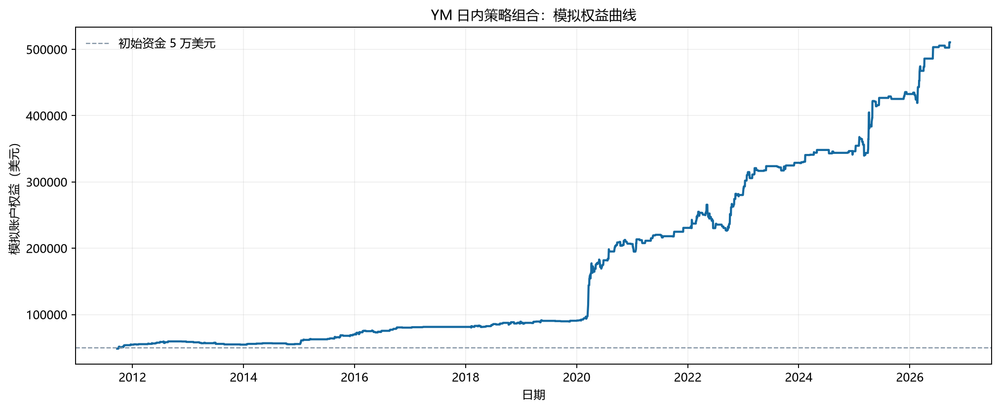
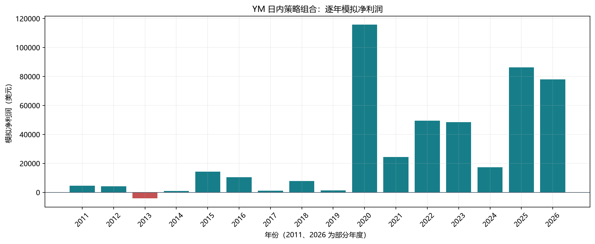
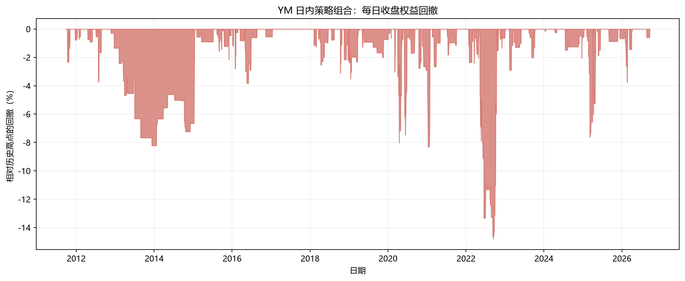

# YM 日内量化策略｜15 年回测累计收益 +921.28%，年化 16.76%

**中文版** · [English](README.en.md)

本仓库整理用户提供的 YM 期货五规则日内策略组合（S1、S2、A1、A2、A3）回测结果，包含逐笔交易、统计表、图表和数据一致性校验代码。所有收益均为**历史模拟，不是实盘记录或未来收益预测**。结果压缩包没有生成这套五规则回测的完整源码，因此无法从本仓库的文件独立重跑策略。

## 回测概览

| 项目 | 结果或假设 |
|---|---:|
| 交易标的 | CME 小型道琼斯工业平均指数期货 YM；每指数点每手 $5 |
| 行情资料 | 用户研究资料记录为 Databento `GLBX.MDP3`、`ohlcv-1m`、连续符号 `YM.v.0` |
| 回测时间 | 2011 年 9 月 23 日至 2026 年 9 月 22 日，约 15 年；首尾均为不完整年度 |
| 初始／期末模拟资金 | $50,000／$510,640 |
| 净利润／累计收益／复合年化收益 | **$460,640／+921.28%／16.76%** |
| 已完成组合交易 | **406 笔**：做空 358 笔、做多 48 笔；这是交易笔数，不是券商委托消息数 |
| 胜率／盈利因子 | 59.85%／2.29 |
| 日收益年化夏普／报告中的索提诺 | 1.36／1.00 |
| 最大收盘权益回撤／盘中回撤 | −14.80%／−15.07% |
| 假设交易成本 | 每手每边手续费 $2.50；进出场各计 1 指数点不利滑点；每手往返共 $15 |
| 仓位控制 | 每笔保证金**预算**为交易前权益的 50%；实际模型保证金占权益 37.82%–49.99%；组合每笔 3–12 手 |

夏普按逐日权益变化和 √252 年化，未扣无风险利率。复合年化收益按上述起止日期的日历跨度计算。50% 指保证金预算，**不是**每笔最多亏损 50% 本金的风险规则。模型以每手名义价值的 9% 计算保证金；这是研究中的仓位参数，**不是**历史券商或 CME 的实际保证金标准。配置文件中的 `CONTRACTS=1` 用于单规则独立测试；组合实际手数以逐笔记录为准。

## 策略规则与交易时间

入场时间为**纽约时间 09:30 或 09:45**，计划离场时间为**09:45、10:00 或 10:30**；逐笔记录中也有遇到反向信号提前离场的情况。下列条件直接摘自提供的 `config.json`。各特征的精确定义和分钟线内成交方法仍需缺失的源码确认。

| 规则 | 方向 | 入场 → 计划离场（纽约时间） | 存档条件 |
|---|---|---|---|
| S1 | 做多 | 09:45 → 10:30 | `ov_ret <= -0.29% AND europe >= +0.14%` |
| S2 | 做空 | 09:30 → 10:00 | `pre <= -0.19% AND late30 >= +0.03%` |
| A1 | 做空 | 09:30 → 10:00 | `asia >= +0.13% AND europe <= -0.29%` |
| A2 | 做空 | 09:45 → 10:30 | `evening <= -0.27% AND prev_rth_closepos >= 0.75` |
| A3 | 做空 | 09:45 → 10:30 | `ov_ret <= -0.28% AND prev_rth_ret >= +0.80%` |

一笔组合交易可能由多个信号共同触发。`strategy_summary.csv` 与 `strategy_independent_trades.csv` 是各规则独立单手测试，**不能**直接相加为动态仓位组合的 $460,640 收益。

## 逐年表现

| 年份 | 已完成交易 | 模拟净利润 |
|---:|---:|---:|
| 2011* | 13 | $4,520 |
| 2012 | 25 | $4,165 |
| 2013 | 11 | −$4,090 |
| 2014 | 11 | $930 |
| 2015 | 30 | $14,250 |
| 2016 | 27 | $10,445 |
| 2017 | 2 | $1,120 |
| 2018 | 35 | $7,875 |
| 2019 | 20 | $1,405 |
| 2020 | 66 | $115,750 |
| 2021 | 22 | $24,360 |
| 2022 | 54 | $49,560 |
| 2023 | 25 | $48,575 |
| 2024 | 16 | $17,385 |
| 2025 | 31 | $86,385 |
| 2026* | 18 | $78,005 |

\* 不完整年度。2020 年与 2025–2026 年对总收益贡献较大。现有资料无法确认哪些年份真正用于样本外检验，也无法确认规则筛选过程是否利用过全部年份。

## 图表

其他月度和单规则中文图表见 [`reports/ym_sa/charts/zh`](reports/ym_sa/charts/zh)。

## 文件与复核方式

- [`portfolio_trades.csv`](reports/ym_sa/portfolio_trades.csv)：406 笔已完成组合交易的时间、信号、手数、扣除假设成本后的净收益和模型保证金。
- [`portfolio_summary.csv`](reports/ym_sa/portfolio_summary.csv)、[`portfolio_yearly.csv`](reports/ym_sa/portfolio_yearly.csv)、[`portfolio_monthly.csv`](reports/ym_sa/portfolio_monthly.csv)：组合汇总、逐年和逐月表现。
- [`daily_equity_drawdown.csv`](reports/ym_sa/daily_equity_drawdown.csv)、[`intraday_equity_drawdown.csv`](reports/ym_sa/intraday_equity_drawdown.csv)：权益和回撤记录。
- [`config.json`](reports/ym_sa/config.json)、[`YM_SA_backtest_report.xlsx`](reports/ym_sa/YM_SA_backtest_report.xlsx)：原始配置和工作簿。
- [`scripts/verify_ym_report.py`](scripts/verify_ym_report.py)：核对 406 笔逐笔收益与逐年收益是否均等于 $460,640。在仓库根目录运行 `python scripts/verify_ym_report.py`；只需 Python 标准库。
- [`scripts/plot_ym_chinese.py`](scripts/plot_ym_chinese.py)：从公开统计表重新绘制七张中文图；安装 `requirements.txt` 后运行 `python scripts/plot_ym_chinese.py`。

上述校验只核对**已经发布的结果表**。原始一分钟行情没有随仓库发布，因为行情再分发权限尚未确认；五规则策略引擎也未包含。因此成交细节、信号构造、筛选偏差和未来表现尚未独立验证。本仓库展示的是所提供的模拟记录，不构成可独立复现的交易系统或投资建议。
