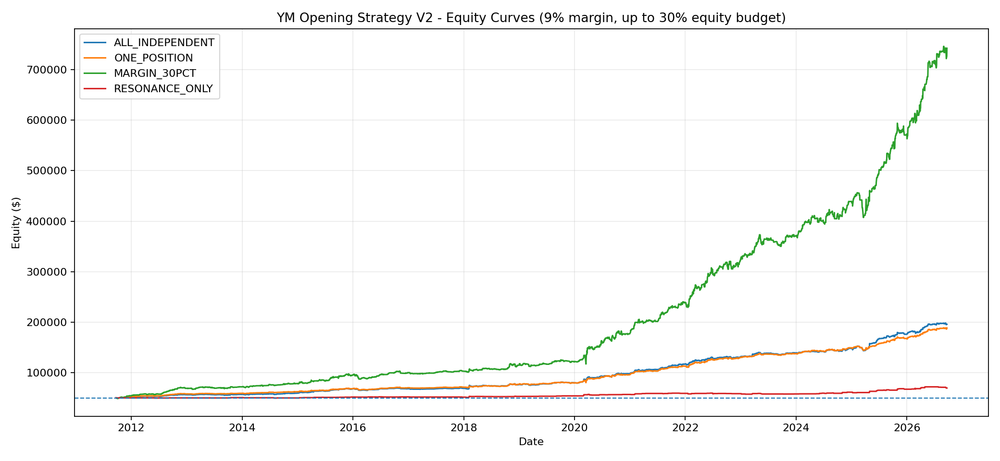

# YM 日内黑箱策略早期拟合版｜约 15 年模拟累计 +1,384.98%，复合年化 19.71%

**中文版** · [English](README.en.md) · [仓库首页](../../README.md)

这是早期 **12 规则拟合版** 的独立存档，对应原始代码标题中的 “V2”。它与仓库首页的后期五规则 S/A 组合是两套不同策略，收益不能合并。数据和代码已经过逐项核对；这里的数字均为**历史模拟结果，不是实盘收益或可实现收益承诺**。

## 交易资料与仓位

| 项目 | 存档口径 |
|---|---|
| 标的与数据 | YM（CME 小型道指期货），连续合约一分钟 K 线；本地研究资料为 Databento `GLBX.MDP3`、`ohlcv-1m`、`YM.v.0` |
| 回测区间 | 2011-09-23 至 2026-09-22，首尾年度不完整 |
| 信号与持仓 | 12 条规则（A、B、C、D、E、F、G、I、J、K、M、N5）；纽约时间 09:30 或 09:45 入场，通常在 09:45、10:00 或 10:30 平仓；冲突信号依源码处理 |
| 初始权益 | $50,000 |
| 主报告仓位 | 每笔可用保证金预算为交易前权益的 30%；每手理论保证金按 YM 名义价值的 9% 估算，整数手数；平均 4.11 手，最多 9 手 |
| 成本假设 | 每手每边手续费 $2.50、进出场各 1 指数点不利滑点；YM 每点每手 $5，因此每手往返共 $15 |
| 订单计数 | 1,652 笔已完成组合交易、1,631 个不同交易日期；不是券商委托消息或成交回报条数 |

30% 是**保证金预算**，不是止损上限。9% 为代码里的仓位模型参数，不代表历年交易所或券商实际保证金。资金曲线按净收益逐日复利；夏普和索提诺基于日权益变化。此版本没有容量、市场冲击或实际保证金变动的完整模拟。

## 30% 预算主结果

| 指标 | 结果 |
|---|---:|
| 完成交易 | **1,652 笔**（盈利 973、亏损 663、持平 16） |
| 期末权益 / 净利润 | **$742,490 / $692,490** |
| 累计收益 / 复合年化 | **+1,384.98% / 19.71%** |
| 胜率 / 盈利因子 | 58.90% / 1.69 |
| 年化日夏普 / 年化日索提诺 | 1.75 / 1.68 |
| 最大每日收盘权益回撤 | −12.76% |
| 平均 / 最大手数 | 4.11 / 9 |

同一份 30% 结果包还存有三组对照：12 条规则各自固定一手独立交易（2,132 笔，净利 $145,730）、每次只持有一个一手头寸（1,652 笔，净利 $138,445），以及仅共振信号一手交易（167 笔，净利 $19,480）。这些对照与主组合的仓位方法不同，不能当成主组合的额外收益。

## 文件

- [原始回测代码](code/backtest_12_rules_30pct.py)：从本地 Notebook 对应代码单元原样导出，共 907 行；无下载 API 密钥。运行前需要自行准备有使用权的 YM 一分钟 Parquet，并修改代码顶部的 `DATA_PATH`。代码将按原逻辑输出结果，不是已经修复前瞻问题的生产版。
- [30% 组合汇总](results/backtest_30pct/portfolio_summary.csv)、[逐笔交易](results/backtest_30pct/trades_MARGIN_30PCT.csv)、[每日权益](results/backtest_30pct/equity_MARGIN_30PCT.csv)、[分年度](results/backtest_30pct/portfolio_yearly_pnl.csv)、[分月度](results/backtest_30pct/portfolio_monthly_pnl.csv)、[参数](results/backtest_30pct/config.json)。`results/backtest_30pct/` 下还有对照模式、信号和诊断表。
- [MAE/MFE 逐笔数据](results/mae_100pct/all_trades_MAE_MFE.csv)及[盈利交易回撤分布图](results/mae_100pct/winning_trade_MAE.png)：**这套 MAE 数据是另一次 100% 保证金预算重跑，不是 30% 主结果的逐笔账户回撤。**

原始一分钟行情和含大量取样价格的逐日特征表没有在公开仓库再分发。其他发布文件是原 ZIP 中的结果或对应代码；仓库内未放 API 密钥。

## 独立核对与重要限制

本地从 5,089,241 条 YM 分钟记录重新计算 3,866 个交易日的特征，与存档特征逐项一致。再按找到的原策略代码重跑，30% 主组合的 1,652 笔交易在日期、方向、进出场时间与价格、手数及净收益上全部匹配。四种模式的汇总和资金曲线也可由逐笔记录核对；MAE/MFE 表的 1,652 笔区间极值与分钟行情扫描一致。这证明存档的**计算一致性**，不证明样本外有效性或实盘可成交性。

1. `portfolio_summary.csv` 的 `trade_days=1615` 是**当日净收益不为零**的天数；实际有交易的不同日期为 **1,631** 天。16 天的净收益为零。
2. 原代码在早盘入场前用 `rth_n >= 388` 和当天 `current_inst_n == 1` 判断有效日，包含当天后续时段的信息。至少 **71 个存在信号的日子**因此被事后剔除。尚未用只含入场时可知信息的筛选重测收益。
3. 存档的 TRAIN/VALID/TEST 是历史日期分段。源码注释显示规则触发次数曾参照整个 2011–2026 样本；没有阈值冻结证据，因此分段名称不能证明独立样本外检验。
4. 冲突规则使用无序集合迭代；2016-11-09 和 2022-07-01 的 E/N5 归因标签可能互换。本次两条规则方向、时间、价格相同，且未按分数缩放仓位，资金结果未受影响。
5. 100% 预算 MAE 重跑的理论期末权益达到 **$605,532,880**，最大一笔 **26,011 手**。其结果没有实际市场容量约束，不能当作可交易收益。MAE 表中沿用的 `MARGIN_30PCT` 模式标签具有误导性，应以**100% 预算**理解该目录。

研究下一步应先修正入场前有效日筛选、固定冲突优先级，再使用真正未参与规则设计的时段与现实成交容量复测。
